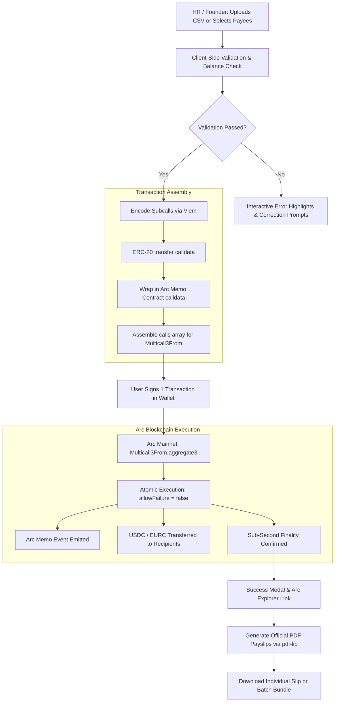

# PayRun 💸

> **Atomic, 1-Click Batch Payroll & Grants Distribution on Arc Network**  
> *Built for the [DoraHacks Arc Microgrants](https://dorahacks.io/hackathon/arc-microgrants/detail) by Circle*

[-10b981?style=for-the-badge&logo=ethereum)](https://explorer.arc.io)
[](https://www.circle.com/en/usdc)
[](https://nextjs.org)
[](LICENSE)

---

## 🌟 Overview

**PayRun** is a high-speed, non-custodial batch payroll and grants payout application built specifically for **Arc Network**. It enables Web3 founders, DAOs, and hackathon organizers to pay an entire team or distribute grants in **a single on-chain transaction** with sub-second finality and zero token approvals.

By leveraging Arc's native USDC gas settlement, Arc's unique **`Multicall3From`** contract, and Arc's native **`memo`** contract, PayRun eliminates the pain of repetitive single payouts, eliminates approval risks, attaches human-readable payment memos directly on-chain, and automatically generates verifiable, audit-ready **PDF payslips** directly in the browser.

---

## 🎯 The Problem & The Arc Advantage

| Pain Point in Traditional Web3 Payroll | How PayRun Solves It on Arc |
|---|---|
| **Dozens of tedious manual transfers**: Sending 50 transactions consumes hours and invites costly copy-paste errors. | **1-Click Atomic Batching**: Pay up to 200 recipients simultaneously in a single transaction via `Multicall3From`. |
| **Approval Fatigue & Security Risks**: Standard batching contracts require approving high token allowances before transferring. | **Zero Approvals Required**: Arc's `Multicall3From` delegates execution directly from the user's EOA, requiring **no prior ERC-20 approvals**. |
| **Volatile Gas & Complex Conversions**: Paying gas in volatile native assets (ETH, MATIC) introduces accounting friction. | **USDC as Native Gas**: On Arc, gas is paid natively in **USDC**, ensuring transparent corporate bookkeeping. |
| **No Payment Context on Explorer**: Raw ERC-20 transfers show arbitrary hashes with zero metadata for recipients or accountants. | **Native On-Chain Memos**: Every payout subcall is encoded through Arc's native `memo` contract, permanently recording reference notes on-chain. |
| **Missing Compliance & Tax Slips**: Recipients receive tokens with no proof of pay or formal pay stub. | **Instant PDF Payslips**: Pure client-side PDF generation (`pdf-lib`) creates individualized or bulk-packaged PDF payslips with block hash verification. |

---

## 🚀 Key Features

- **⚡ Single-Transaction Batch Payouts**: Distribute USDC or EURC to up to 200 recipients in under a second.
- **🛡️ Atomic "All-or-Nothing" Execution**: Uses `allowFailure: false` in `aggregate3`. If even one transfer would fail (e.g., insufficient balance or invalid parameters), the entire batch reverts, preventing partial payments.
- **🏷️ On-Chain Memos via Arc Memo Contract**: Transparently encodes invoice numbers, employee names, and salary descriptions directly into the transaction calldata.
- **📄 Client-Side Audit-Ready PDF Payslips**:
  - Individual payslip download for each employee.
  - Multi-page unified PDF bundle or ZIP for corporate record-keeping.
  - Encodes transaction hash, block timestamp, sender, recipient, and memo.
- **📋 Smart CSV Parser & Real-Time Validator**:
  - Drag-and-drop or paste CSV files with auto-detect delimiters.
  - Live EIP-55 address checksum validation and zero-address rejection.
  - Real-time balance sufficiency check against connected wallet balance.
- **👥 Built-in Payee Directory & Run History**:
  - Save frequent contractors and team members with custom role tags.
  - Persist historical payroll runs locally with one-click receipt inspection and re-downloadable payslips.
- **💶 Multi-Currency Support**: Full support for Circle **USDC** and **EURC**.

---

## 🏗️ Architecture & Workflow



---

## 📜 Deployed Contracts & Network Specifications

PayRun operates directly with the native protocol contracts deployed on **Arc Mainnet** and **Arc Testnet**:

### Arc Mainnet (Chain ID: `5042`)
- **Network Name**: Arc Mainnet
- **Chain ID**: `5042` (`0x13B2`)
- **Native Currency**: `USDC` (18 decimals)
- **RPC URL**: `https://rpc.mainnet.arc.io` (Fallback: `https://rpc.drpc.mainnet.arc.io`)
- **Block Explorer**: [https://explorer.arc.io](https://explorer.arc.io)

| Contract | Address | Description |
|---|---|---|
| **USDC (Native)** | [`0x3600000000000000000000000000000000000000`](https://explorer.arc.io/address/0x3600000000000000000000000000000000000000) | Arc Native USDC Contract |
| **EURC** | [`0xbEf5f6d51CB62b58e6A8f77868681825C6fe21c1`](https://explorer.arc.io/address/0xbEf5f6d51CB62b58e6A8f77868681825C6fe21c1) | Circle Euro Stablecoin |
| **Multicall3From** | [`0x522fAf9A91c41c443c66765030741e4AaCe147D0`](https://explorer.arc.io/address/0x522fAf9A91c41c443c66765030741e4AaCe147D0) | Atomic Multicall preserving EOA sender |
| **Memo Contract** | [`0x5294E9927c3306DcBaDb03fe70b92e01cCede505`](https://explorer.arc.io/address/0x5294E9927c3306DcBaDb03fe70b92e01cCede505) | Native On-chain Memo Logger |

### Arc Testnet (Chain ID: `5042002`)
- **Network Name**: Arc Testnet
- **Chain ID**: `5042002` (`0x4CEEFA`)
- **RPC URL**: `https://rpc.testnet.arc.network`
- **Block Explorer**: [https://explorer.testnet.arc.network](https://explorer.testnet.arc.network)

| Contract | Address |
|---|---|
| **Multicall3From** | `0x522f6b60021c3f91f3B98D5A344d5c1B85D347D0` |
| **Memo Contract** | `0x5294E9927c3306DcBaDb03fe70b92e01cCede505` |
| **USDC** | `0x3600000000000000000000000000000000000000` |
| **EURC** | `0x89B50855Aa3bE2F677cD6303Cec089B5F319D72a` |

---

## 📁 CSV Import Specification

PayRun accepts CSV uploads with standard column headers:

```csv
name,address,amount,currency,memo
Ada Lovelace,0xF4948E13E95fb5d3F5a2f7F9a354D1D5F1c9E554,2500.00,USDC,October 2026 Core Engineering
Charles Babbage,0x71C84194E38350E01a13501a1e053fC67e3a9F80,1800.50,USDC,October 2026 Systems Architecture
Alan Turing,0x3C44CdDdB6a900fa2b585dd299e03d12FA4293BC,1500.00,EURC,Cryptography Research Grant
```

### Validation Rules:
1. **`address`**: Must be a valid 42-character hexadecimal Ethereum/EVM address. Checks for EIP-55 checksum compliance and disallows the zero address (`0x0...0`).
2. **`amount`**: Must be a positive decimal number greater than 0. Formatted with 6 decimals precision (matching USDC/EURC).
3. **`memo`** (optional): Plaintext payment reference automatically encoded into `bytes` for the Arc Memo contract.

---

## 💻 Tech Stack

- **Framework**: [Next.js 16](https://nextjs.org/) (App Router, React 19)
- **Web3 & Blockchain**:
  - [Viem](https://viem.sh/) (Typed Ethereum interface & calldata encoding)
  - [Wagmi](https://wagmi.sh/) (React hooks for wallet connectivity & transaction lifecycle)
  - [ConnectKit](https://docs.family.co/connectkit) (Seamless multi-wallet modal)
  - [@tanstack/react-query](https://tanstack.com/query) (Asynchronous state cache)
- **Styling**: [Tailwind CSS 4](https://tailwindcss.com/)
- **Document Generation**: [pdf-lib](https://pdf-lib.js.org/) (Client-side vector PDF generation) & [JSZip](https://stuk.github.io/jszip/)
- **Parsing & Validation**: [PapaParse](https://www.papaparse.com/) & [Zod](https://zod.dev/)

---

## 🛠️ Quick Start & Local Development

### 1. Prerequisites
- **Node.js**: `v20.x` or higher
- **Package Manager**: `pnpm` (recommended), `npm`, or `yarn`

### 2. Clone the Repository
```bash
git clone https://github.com/Miss-shelby/PayRun.git
cd PayRun
```

### 3. Install Dependencies
```bash
pnpm install
```

### 4. Configure Environment Variables
Copy `.env.example` to `.env.local`:
```bash
cp .env.example .env.local
```

Configure your network preferences:
```env
# Choose 'mainnet' or 'testnet'
NEXT_PUBLIC_ARC_NETWORK=mainnet

# Optional custom RPC URL
NEXT_PUBLIC_RPC_URL=https://rpc.mainnet.arc.io

# Optional WalletConnect Project ID
NEXT_PUBLIC_WALLETCONNECT_PROJECT_ID=
```

### 5. Verify Network Connectivity
Run the included chain diagnostic script to test your RPC connection and verify contract readability:
```bash
pnpm exec tsx scripts/01-read-chain.ts
```

### 6. Start the Local Development Server
```bash
pnpm dev
```
Open [http://localhost:3000](http://localhost:3000) in your browser.

---

## 🧪 Testing & Validation

The codebase includes comprehensive unit tests verifying:
- CSV syntax, delimiter edge cases, and invalid address rejection (`src/lib/payroll/parseCsv.test.ts`).
- Subcall encoding logic, transfer signatures, and memo wrapping (`src/lib/chain/encoding.test.ts`).
- Network configuration consistency and chain IDs (`src/lib/chain/config.test.ts`).

Run the test suite:
```bash
pnpm test
```

---

## 🏆 DoraHacks Arc Microgrants Alignment

This project was built for the **[DoraHacks Arc Microgrants](https://dorahacks.io/hackathon/arc-microgrants/detail)** powered by **Circle**:

1. **Live & Functional on Arc Mainnet**: Direct interaction with deployed Mainnet contracts (Chain ID `5042`).
2. **First-Class Circle USDC & EURC Integration**: Employs USDC as both gas and the payout currency, eliminating token volatility for businesses.
3. **Ecosystem-Native Innovation**: Leverages Arc's unique infrastructure (`Multicall3From` and `memo`), which are not available in this configuration on standard EVM L2s.
4. **Immediate Real-World Utility**: Solves a pressing daily challenge for Web3 organizations: frictionless, compliant, atomic team compensation.

---

## 🗺️ Roadmap

- [x] Full Arc Mainnet & Testnet deployment support
- [x] Zero-approval batch payouts via `Multicall3From`
- [x] On-chain memo logging via native Arc `memo` contract
- [x] Client-side single and multi-page PDF payslip generation
- [x] Payee address book and local run history
- [ ] Safe (Multisig) batch execution plugin
- [ ] Streaming payroll integration (Sablier / Superfluid primitives on Arc)
- [ ] Accounting export integration (Xero / QuickBooks CSV templates)

---

## 📄 License

This project is open-source under the [MIT License](LICENSE).
